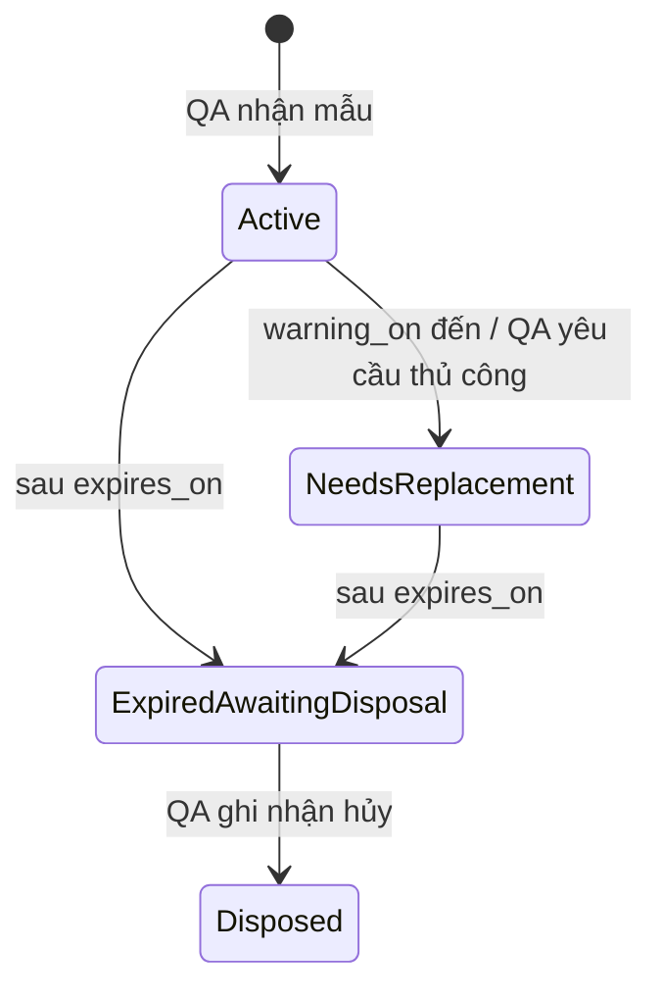
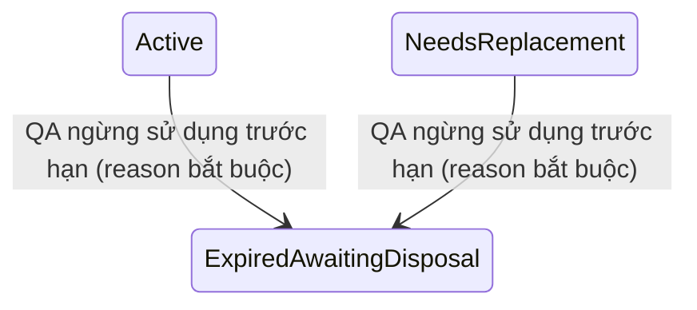

# Thiết kế — Quản lý mẫu chuẩn

## 1. Tổng quan

Tính năng bổ sung mô hình quản lý mẫu chuẩn tối giản, lấy **Item** làm nơi khai báo chính sách và lấy **lần QA nhận mẫu** làm đơn vị vòng đời. Thiết kế chủ ý không xây dựng sổ tồn hay luồng R&D ký chuẩn.

Mục tiêu kỹ thuật là bảo đảm: một mẫu nhận có thông tin snapshot đủ để truy vết; ngày cảnh báo được xác định duy nhất từ lead time của Item; các thay đổi trạng thái được kiểm soát; và cảnh báo không bị gửi/trạng thái không bị cập nhật lặp.

## 2. Quyết định thiết kế

| ID | Quyết định | Lý do |
|---|---|---|
| D1 | Hạn sử dụng tính từ ngày QA nhận mẫu. | Đây là thời điểm QA bắt đầu chịu trách nhiệm và luôn có trong nghiệp vụ. Ngày lấy mẫu vẫn được lưu để truy xuất. |
| D2 | Không có trường cấu hình “ngày cảnh báo trước hạn”. | Tránh hai nguồn dữ liệu mâu thuẫn; cảnh báo luôn dựa trên lead time. |
| D3 | Mỗi lần QA nhận là một bản ghi mẫu mới. | Hỗ trợ nhiều mẫu/lô đồng thời và giữ lịch sử; không phân biệt tái ký/cấp mới. |
| D4 | Snapshot chính sách Item tại thời điểm nhận. | Thay đổi Item tương lai không sửa lịch sử hoặc tạo dịch chuyển hạn bất ngờ. |
| D5 | Mẫu cũ không tự động bị hủy khi có mẫu mới. | Hủy là hành động vật lý cần QA xác nhận, có audit trail. |
| D6 | QR chỉ chứa định danh nội bộ/token nội bộ. | Hạn chế lộ dữ liệu khi tem bị nhìn thấy hoặc chuyển ra ngoài. |

## 3. Mô hình dữ liệu khái niệm

Tên bảng/cột thực tế phải theo quy ước migration hiện có của DCS; các tên bên dưới là mô hình để triển khai.

### 3.1 Cấu hình mẫu chuẩn Item

`item_reference_sample_config`

| Trường | Mô tả |
|---|---|
| item_id (PK/FK) | Item được cấu hình, tối đa một cấu hình hiện hành mỗi Item. |
| managed | Cờ quản lý mẫu chuẩn. |
| sample_unit | Đơn vị tham chiếu. |
| reference_quantity | Lượng hướng dẫn, không được dùng làm ledger. |
| shelf_life_days | Thời hạn tính theo ngày, > 0. |
| replacement_lead_time_days | Lead time tính theo ngày, > 0 và < shelf_life_days. |
| storage_condition | Điều kiện bảo quản chuẩn. |
| notification_recipients | Quan hệ hoặc cấu trúc theo cơ chế người dùng/role hiện có. |
| created/updated audit fields | Audit chuẩn. |

Không tạo cột cho cảnh báo trước hạn độc lập. Giá trị tương đương, khi hiển thị, được suy diễn bằng `replacement_lead_time_days`.

### 3.2 Bản ghi mẫu chuẩn nhận

`reference_samples`

| Trường | Mô tả |
|---|---|
| reference_sample_id | Định danh mẫu do hệ thống sinh, dùng trên tem/QR. |
| item_id | Item của mẫu. |
| related_lot | Lô liên quan, nullable. |
| sampled_at | Ngày lấy mẫu, nullable nếu chưa cung cấp. |
| received_at | Ngày QA nhận; bắt buộc. |
| received_quantity, unit | Thông tin in/tra cứu, không làm giảm trừ. |
| shelf_life_days_snapshot | Snapshot cấu hình. |
| lead_time_days_snapshot | Snapshot cấu hình. |
| storage_condition_snapshot | Snapshot cấu hình tại lúc nhận, có thể cho phép QA nhập giá trị thực tế theo quyền. |
| notification_recipients_snapshot | Snapshot nơi nhận cảnh báo. |
| expires_on | `received_at + shelf_life_days_snapshot`. |
| warning_on | `expires_on - lead_time_days_snapshot`. |
| location fields | Khu vực/phòng, tủ/kho, ngăn-kệ-vị trí hoặc FK sang danh mục vị trí. |
| handover_by, received_by | Người R&D bàn giao và QA nhận. |
| state | active, needs_replacement, expired_awaiting_disposal, disposed. |
| notes, attachments | Thông tin bổ sung. |
| audit fields | Người/thời điểm tạo, cập nhật. |

Ràng buộc dữ liệu: `expires_on >= received_at`; `warning_on <= expires_on`; snapshot thời hạn lớn hơn lead time; `disposed` chỉ tồn tại cùng thông tin hủy hợp lệ.

### 3.3 Yêu cầu lấy mẫu mới

`reference_sample_requests`

| Trường | Mô tả |
|---|---|
| request_id | Định danh yêu cầu. |
| item_id | Item bắt buộc. |
| reference_sample_id | Mẫu nguồn nếu yêu cầu được tạo từ mẫu; nullable với yêu cầu theo Item. |
| reason | Enum lý do theo requirements. |
| status | Tối thiểu open/closed hoặc trạng thái tương đương theo convention hiện có. |
| requested_by, requested_at | Audit nghiệp vụ. |
| notes | Diễn giải. |
| resolved_by, resolved_at | Nếu cần đóng thủ công. |

Một chỉ mục/rule phải phát hiện yêu cầu mở trùng cho cùng `reference_sample_id` hoặc cùng Item theo chính sách được xác nhận trong quá trình triển khai. UX mặc định là báo yêu cầu đang mở và dẫn người dùng đến yêu cầu đó, thay vì tạo trùng.

### 3.4 Hủy và audit

`reference_sample_disposals` giữ `reference_sample_id`, ngày hủy, lý do, người thực hiện, người phê duyệt/chứng kiến tùy chọn, ghi chú và attachment. Bảng/audit event phải được append-only; không xóa bản ghi mẫu hoặc sự kiện nghiệp vụ.

Sử dụng cơ chế audit hiện hữu của DCS nếu có; không tạo một audit framework song song.

## 4. Luồng và chuyển trạng thái



- `Active` tương ứng **Đang lưu / Có hiệu lực**.
- `NeedsReplacement` tương ứng **Cần thay mẫu**.
- `ExpiredAwaitingDisposal` tương ứng **Hết hạn / Chờ hủy**.
- `Disposed` tương ứng **Đã hủy**.

Tạo Yêu cầu lấy mẫu mới là một event liên quan, không phải một trạng thái mẫu. Nhận mẫu thay thế tạo bản ghi `reference_samples` mới ở `Active`; không làm biến đổi bản ghi cũ tự động.

## 5. Tính ngày và job cảnh báo

Tất cả phép tính dùng timezone nghiệp vụ hiện hành của DCS và chuẩn hóa về ngày lịch (không dựa vào giờ chạy job).

```text
expires_on = calendarAddDays(received_at, shelf_life_days_snapshot)
warning_on = calendarAddDays(expires_on, -lead_time_days_snapshot)
```

Job chạy tối thiểu hằng ngày và idempotent:

1. Chọn mẫu chưa Disposed.
2. Nếu `today > expires_on`, đặt `ExpiredAwaitingDisposal` nếu chưa ở trạng thái này/Disposed; tạo một audit event và thông báo expiry một lần.
3. Nếu `today >= warning_on` và `today <= expires_on`, đặt `NeedsReplacement` nếu đang Active; tạo một audit event và cảnh báo một lần cho snapshot recipients.
4. Không chuyển `ExpiredAwaitingDisposal` trở về `NeedsReplacement`.
5. Nếu delivery notification thất bại, ghi lỗi vận hành có thể retry; dashboard/list vẫn là nguồn cảnh báo bắt buộc.

Khi nhận mẫu, domain phải tính dates ngay trong transaction. Nếu sample đã hết hạn theo dữ liệu nhập, tạo ở trạng thái ExpiredAwaitingDisposal; nếu đã đến warning nhưng chưa hết hạn, tạo NeedsReplacement.

## 6. API/UI ở mức khái niệm

Thiết kế endpoint, template và service phải theo pattern router/domain/view hiện hành của DCS; tên chính xác được xác định sau khi khảo sát module liên quan.

Các capability cần có:

- Trang cấu hình mẫu chuẩn của Item.
- Danh sách mẫu QA: filter theo Item, nhóm, trạng thái, hạn, vị trí, lô và người nhận.
- Form QA nhận mẫu (tự hiển thị giá trị Item snapshot và ngày tính).
- Trang chi tiết mẫu có timeline/audit, QR/print, các yêu cầu liên quan và hủy.
- Form tạo Yêu cầu lấy mẫu mới, từ sample hoặc Item.
- Form hủy mẫu với guard trạng thái.
- Dashboard widget/list cho NeedsReplacement và ExpiredAwaitingDisposal.
- Trang/route quét QR có kiểm tra xác thực và authorization theo capability hiện hữu.

Mọi mutation phải validate tại domain/service layer và kiểm tra quyền tại server. UI chỉ phản ánh capability, không thay thế authorization.

## 7. QR và tem

`reference_sample_id` có thể được bọc trong token/ngữ cảnh QR có thể thu hồi theo cơ chế token hiện hữu nếu dự án có. Nếu chưa có cơ chế dùng lại được, QR phải chứa một định danh opaque đủ để route nội bộ tra cứu có phân quyền.

Tem được render từ bản ghi snapshot hiện hành; không dựa vào cấu hình Item hiện tại để in lại thông tin lịch sử. In lại tem tạo audit event riêng và không thay đổi state của mẫu.

## 8. An toàn dữ liệu, phân quyền và migration

- Migration phải forward-only, không sửa migration đã áp dụng.
- Kiểm tra preflight với Item/lô/user tham chiếu trước khi thêm FK/ràng buộc bắt buộc.
- Cấu hình Item và thao tác hủy cần capability rõ ràng; hủy có thể yêu cầu approval/witness tùy cấu hình chính sách, không tự giả định luồng phê duyệt.
- `Disposed` phải là terminal state trên API/domain, trừ thao tác quản trị được phê duyệt và vẫn phải tạo event bù trừ; không cập nhật trực tiếp để xóa lịch sử.
- Attachment dùng cơ chế file-store DCS hiện có và kế thừa kiểm soát truy cập của bản ghi cha.

## 9. Điểm cần xác nhận trước triển khai — đã được thay thế bởi quyết định MVP

> Các câu hỏi lịch sử bên dưới được giữ lại để truy vết. Quyết định có hiệu lực để triển khai nằm tại §10; không xem đây là các gate chờ phê duyệt.

1. Có danh mục Item, vị trí kho/tủ và role/capability nào có thể tái sử dụng không?
2. Cảnh báo cần gửi qua kênh nào ngoài dashboard (email, in-app, cả hai)?
3. Danh sách người nhận trong cấu hình là user cụ thể, role, hay cả hai?
4. Hủy mẫu có bắt buộc approver/witness cho mọi trường hợp hay tùy site/nhóm Item?
5. Khi một yêu cầu mới đã mở theo Item nhưng không gắn sample cụ thể, chính sách đóng/liên kết yêu cầu khi mẫu mới được nhận là gì?

Các câu hỏi này không ngăn việc chốt scope nghiệp vụ, nhưng phải được giải quyết trong discovery trước khi chốt schema/API.


## 10. Quyết định MVP đã chốt

Các mục từng là điểm cần xác nhận ở phần 9 được chốt như sau và thay thế phần đó khi triển khai.

| Chủ đề | Quyết định MVP |
|---|---|
| Danh mục Item | Dùng danh mục DCS nếu khảo sát xác nhận có thể tái sử dụng; nếu không, tạo danh mục Item nội bộ tối giản với `item_code` unique, `item_name`, `item_group`, `is_active`. Không tích hợp ERP/LIMS. |
| Vị trí lưu | Tạo danh mục nội bộ ba cấp `area_or_room → cabinet_or_storage → shelf_or_slot`; sample tham chiếu một vị trí chuẩn và có ghi chú tùy chọn. |
| Quyền | QA thao tác receipt/request/QR/disposal; QA Lead thêm quyền quản lý Item/config/location. R&D chỉ nhận notification, không có workflow ký chuẩn hay cập nhật request. |
| Cảnh báo | In-app + dashboard, không email. Event warning gửi một lần; dashboard nhắc hằng ngày khi chưa có request mở. Expired hiển thị cho tới disposal. |
| Request | Hai state `open`/`closed`; QA tạo request. Khi receipt chọn request mở cùng Item, transaction liên kết record mới và đóng request. Không tạo state xử lý R&D. |
| QR/tem | Browser print template 50 × 30 mm, một sample/một tem. QR là opaque internal ID/token; tra cứu cần authentication và authorization. |
| Hủy | Không thêm approval workflow trong MVP. Disposal bắt buộc date/reason/executor; witness/approver/attachments nullable. |
| Nhiều mẫu | Nhiều record Active cùng Item được phép. Receipt mới không làm đổi state record cũ. QA có action “ngừng sử dụng” với reason để chuyển Active/NeedsReplacement sang ExpiredAwaitingDisposal trước hạn. |

### 10.1 Bổ sung chuyển trạng thái ngừng sử dụng



Đây không phải là trạng thái mới. Domain phải ghi event `reference_sample_withdrawn` với reason thuộc `damaged`, `storage_incident`, `replaced`, hoặc `other` trước khi thực hiện transition. Sau transition, chỉ nghiệp vụ disposal mới có thể làm record đạt `Disposed`.

### 10.2 Điều chỉnh mô hình request

`reference_sample_requests.status` chỉ nhận `open` hoặc `closed`. Khi receipt liên kết `request_id`, transaction phải xác nhận cùng `item_id`, request đang open, liên kết bản ghi mới và đóng request. Một receipt không bắt buộc có request; request không bắt buộc gắn sample nguồn. Cả hai trường hợp phải audit để truy vết.

### 10.3 Hệ quả cho schema và giao diện

- Bổ sung `item_master` và `storage_locations` chỉ khi không có các thực thể tương đương có thể tái sử dụng trong DCS.
- Thêm `reference_sample_requests.fulfilled_by_reference_sample_id` hoặc quan hệ tương đương để truy ngược mẫu đã đáp ứng yêu cầu.
- Thêm action guarded “Ngừng sử dụng” trên màn hình chi tiết sample cho QA/QA Lead; không cho hủy trực tiếp sample đang Active/NeedsReplacement mà không tạo withdrawal event.
- Dashboard xác định nhắc việc request bằng query trạng thái sample + sự tồn tại của open request, không tạo thêm trạng thái sample.
