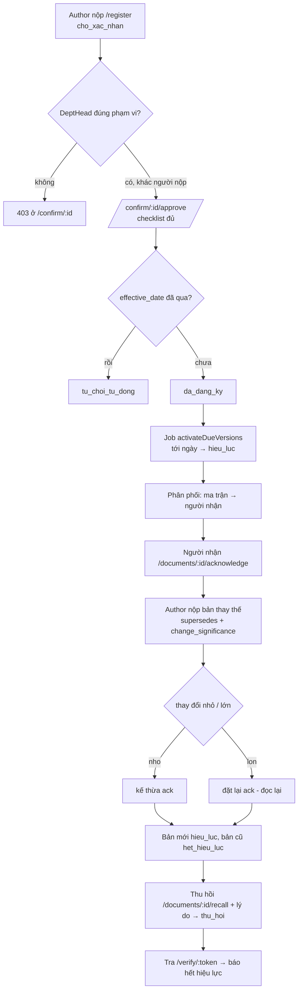

# DCS — Kế hoạch kiểm thử toàn diện (chức năng · flow quy trình · phân quyền chồng chéo)

Phiên bản: 1.0 · Trạng thái: Dùng được cho đội QA

Tài liệu này là kế hoạch kiểm thử **đầy đủ** cho DCS (Document Control System). Nó kế thừa
cấu trúc bảng của `UAT-KICH-BAN-KIEM-THU.md` nhưng **cập nhật theo mô hình phân quyền 3 vai
hiện tại** trong mã nguồn (`src/domain/permissions.ts`, `src/domain/roles.ts`). Phần UAT cũ mô
tả vai cũ (DC_SITE_QA_MANAGER cấp Site, DC_BU_OWNER cấp BU...) đã **lỗi thời** — xem phụ lục
"Khác biệt so với UAT cũ" ở cuối.

Mọi URL/endpoint trong tài liệu đều được đối chiếu với route thật trong `src/routes/*.ts`.

---

## 0. Mục đích · Phạm vi · Đối tượng · Môi trường

### 0.1. Mục đích
Kiểm chứng DCS hoạt động đúng trên ba trục:
1. **Chức năng** — từng tính năng độc lập hoạt động đúng đặc tả.
2. **Flow quy trình** — các luồng nghiệp vụ end-to-end chạy thông suốt, đúng điểm phân nhánh.
3. **Phân quyền chồng chéo** — ma trận quyền và các ca biên về quyền (trọng tâm), bảo đảm
   không rò rỉ quyền và không leo thang quyền sau khi gộp vai (migration 013).

### 0.2. Phạm vi
Bao phủ: đăng nhập/phiên; quản trị tổ chức–người dùng–vai trò; đăng ký ban hành; xác nhận/
release 2 lớp; vòng đời & lên hiệu lực; đọc & xác nhận đọc; tìm kiếm & so sánh phiên bản; in
bản kiểm soát & tra cứu QR công khai; thu hồi; phân phối/ma trận; rà soát định kỳ; gói ban
hành; leo thang; nạp dữ liệu cũ; ghi vết audit.

**Ngoài phạm vi (chưa có route trong `server.ts`):** báo cáo vận hành `/ops/*`, hỏi đáp AI
`/qa`, trang trưng bày `/design`. Các màn này được nhắc trong UAT cũ nhưng **không được đăng
ký** trong `src/server.ts` ở bản hiện tại — xem phụ lục khác biệt. Mở trực tiếp sẽ trả 404 của
Fastify (không có handler), KHÔNG phải 403.

### 0.3. Đối tượng
QA nghiệp vụ, đội triển khai, người dùng đại diện. Người kiểm thử ghi **Đạt / Không đạt** và
ghi chú cho từng ca. Ca gắn `[BẢO MẬT]` là kiểm soát an ninh, **bắt buộc Đạt**.

### 0.4. Môi trường test
| # | Bước | Kỳ vọng |
|---|---|---|
| 0.4.1 | Có **PostgreSQL 16 thật** (cần pgcrypto, unaccent, pg_trgm, vector). Không dùng mock DB. | Kết nối được. |
| 0.4.2 | Tạo DB, cấu hình `.env`: `DATABASE_URL`, `SESSION_SECRET` ≥ 32 ký tự, `FILE_STORAGE_PATH`. | App khởi động không lỗi cấu hình. |
| 0.4.3 | Chạy `npm run migrate` (chạy toàn bộ migration 001→014 theo thứ tự). | Migration chạy xong, không lỗi. |
| 0.4.4 | Chạy `npm run dev` (hoặc bản build đã copy `views`/`public`). | Server lắng nghe ở cổng cấu hình. |
| 0.4.5 | Mở `GET /healthz`. | Trả JSON `{"status":"ok","phase":"lifecycle"}`. |
| 0.4.6 | Tạo admin đầu tiên: `node scripts/create-admin.mjs <email> <mật khẩu> "<Họ tên>"`. | Tạo người dùng; **xem Lưu ý 0.5 về vai trò admin bootstrap**. |

### 0.5. Lưu ý quan trọng về admin bootstrap (phát hiện khi đọc code)
`scripts/create-admin.mjs` gán vai **`DC_GROUP_OWNER`** (vai cũ). Trong mô hình quyền hiện tại:
- `DC_GROUP_OWNER` **không** xuất hiện trong bất kỳ hàm quyết định quyền nào của
  `src/domain/permissions.ts` (không mở cờ Admin, release hay Author).
- Migration **005** có bước backfill: nếu user có `DC_GROUP_OWNER` thì **đồng thời** cấp
  `DC_ADMIN@group`. Migration **013** sau đó map các vai cũ (gồm `DC_GROUP_OWNER`) sang
  `DC_DEPT_HEAD@group` và tắt (`is_active=false`) bản ghi vai cũ.

Hệ quả cần kiểm chứng khi chuẩn bị môi trường:
- Nếu admin được tạo **trước** khi chạy migration 005/013 (quy trình nâng cấp): user sẽ có
  `DC_ADMIN@group` (do backfill 005) → đăng nhập dùng được quyền admin.
- Nếu admin được tạo **sau** khi đã chạy hết migration (cài mới, create-admin chạy cuối): bản
  ghi chỉ có `DC_GROUP_OWNER`, backfill 005 **không chạy lại**, nên user **có thể KHÔNG có
  `DC_ADMIN`** → mất quyền quản trị.

> **Khuyến nghị test tiền đề (ca 0.5.1):** sau khi chạy create-admin, kiểm tra trực tiếp DB:
> `SELECT role_code, scope_level, is_active FROM user_roles WHERE user_id = '<id-admin>';`
> Nếu không thấy `DC_ADMIN` active, cấp thủ công bằng SQL (chèn `DC_ADMIN@group`) rồi mới chạy
> các nhóm C/J. Ghi nhận đây là lỗi cần sửa ở `create-admin.mjs` (nên gán thẳng `DC_ADMIN`).

---

## 1. Mô hình phân quyền hiện tại (căn cứ kiểm thử)

Nguồn: `src/domain/permissions.ts`, `src/domain/roles.ts`, migrations 012/013. Kế hoạch test
dựa hoàn toàn vào đây.

### 1.1. Ba vai + Reader
| Vai | Mã | Ý nghĩa | Scope gán |
|---|---|---|---|
| Admin | `DC_ADMIN` | Quản trị hệ thống; release mọi phạm vi kể cả `group`. | `group` |
| Biên soạn | `DC_AUTHOR` | Đăng ký ban hành, lưu nháp, tạo gói. | `group` |
| Phê duyệt | `DC_DEPT_HEAD` | Xác nhận/release theo phạm vi suy từ Dept chính; thu hồi; sửa ma trận; xem audit. | `group` |
| Chỉ xem | `DC_READER` | Chỉ xem tài liệu hiện hành. | `group` |

Tất cả vai được gán ở `scope_level='group'`. **Phạm vi phê duyệt KHÔNG lấy từ scope của role**
mà **suy từ Dept chính (`primary_dept_id`) của người dùng**: `dept → site` (qua
`org_department.site_id`) `→ bu` (qua `org_site_bu`, quan hệ N:N site–bu).

### 1.2. Vai cũ đã bị gộp (không gán mới được)
`DC_SITE_QA_MANAGER`, `DC_BU_OWNER`, `DC_GROUP_OWNER` đã bị **migration 013** gộp về
`DC_DEPT_HEAD@group` và tắt. UI 3 vai (`grantRole`) **ném `BusinessError('role.scope')`** nếu
cố gán các vai này — xem `normalizeScope` trong `roles.ts`.

### 1.3. Quy tắc quyết định quyền (thuần, `canUserRelease`)
Phải có cờ Phê duyệt (`DC_DEPT_HEAD` **hoặc** `DC_ADMIN`) mới xét tiếp:
- **Admin** → duyệt **mọi** phạm vi, kể cả `group`.
- **`DC_DEPT_HEAD`:**
  - Tài liệu cấp `group` → **KHÔNG** được duyệt (chỉ Admin — chống leo thang sau gộp vai).
  - Cấp `dept` → chỉ khi `userScope.dept_id === doc.scope_dept_id`.
  - Cấp `site` → chỉ khi `userScope.site_id === doc.scope_site_id`.
  - Cấp `bu` → chỉ khi `doc.scope_bu_id ∈ userScope.bu_ids`.
  - **KHÔNG kế thừa chéo:** BU không trùm Site/Dept; Site không trùm Dept.
- Scope null (Dept chính null) → không khớp bất kỳ cấp `dept/site/bu` nào → không duyệt.

### 1.4. Các cổng quyền khác
| Hàm | Điều kiện |
|---|---|
| `isReadOnlyUser` | Không `DC_AUTHOR`, không `DC_DEPT_HEAD`, không `DC_ADMIN` → Reader. |
| `allowedStatusesForViewer` | Reader → chỉ `['hieu_luc','da_dang_ky']`; vai nghiệp vụ → `null` (xem cả lịch sử). |
| `canRegisterDocuments` | Cần `DC_AUTHOR` active. |
| `hasSystemAdminAccess` | Cần `DC_ADMIN` active. |
| `hasAnyReleaseRole` | `DC_DEPT_HEAD` hoặc `DC_ADMIN`. |

### 1.5. Quy tắc hai người (two-person)
Người xác nhận **không được trùng** người nộp. Chặn ở nhiều lớp:
- Route `GET /confirm/:id`: nếu `registrant_user_id === user` → 403.
- Route `GET /pending-confirmation`: loại bỏ bài do chính mình nộp khỏi hàng đợi.
- Domain `confirmRegistration`: ném `BusinessError('conf.same_person')`.
- Checklist mục **3** (`auto/chan`): "Người xác nhận khác người nộp".

> **Phát hiện code (nguồn `getUserScope`):** hàm `getUserScope` truy vấn cột
> `users.primary_dept_id`, nhưng **không có migration nào tạo cột này** (chỉ tham chiếu trong
> `permissions.ts`). Nếu schema thực tế thiếu cột, các ca cần `canRelease` ở cấp `dept/site/bu`
> (không phải Admin) có thể lỗi SQL thay vì trả false. **Ca kiểm thử P.0 bên dưới xác minh điều
> này trước**; nếu lỗi, báo bug schema (thiếu `primary_dept_id`) trước khi chạy phần P còn lại.

---

## 2. CHUẨN BỊ DỮ LIỆU NỀN (bắt buộc trước nhóm P)

Để chạy ma trận quyền và các ca chồng chéo, admin tạo sẵn tổ chức + người dùng sau. Dùng
`/admin/org`, `/admin/users`, `/admin/roles`. Vì Dept chính suy ra phạm vi release, mỗi user
"Phê duyệt" cần được gán Dept chính (`primary_dept_id`) tương ứng — **xem lưu ý 2.3**.

### 2.1. Tổ chức
| Đối tượng | Mã gợi ý | Ghi chú |
|---|---|---|
| BU 1 | `BU-A` | — |
| BU 2 | `BU-B` | — |
| Site X | `SITE-X` | Thuộc **cả BU-A và BU-B** (N:N — thêm BU thứ hai qua `/admin/org/site-bu`). |
| Site Y | `SITE-Y` | Chỉ thuộc BU-A. |
| Dept X1 | `DEPT-X1` | Thuộc Site X. |
| Dept Y1 | `DEPT-Y1` | Thuộc Site Y. |

### 2.2. Người dùng + vai trò
| Người dùng | Mã gợi ý | Vai (đều `group`) | Dept chính | Dùng cho |
|---|---|---|---|---|
| Reader | `u_reader` | `DC_READER` | DEPT-X1 | Ca xem hạn chế, chặn truy cập. |
| Author | `u_author` | `DC_AUTHOR` | DEPT-X1 | Đăng ký, gói, không release. |
| DeptHead Site X | `u_dh_x` | `DC_DEPT_HEAD` | DEPT-X1 (→ Site X → BU-A, BU-B) | Duyệt dept X1 / site X / bu A & B. |
| DeptHead Site Y | `u_dh_y` | `DC_DEPT_HEAD` | DEPT-Y1 (→ Site Y → BU-A) | Ranh giới duyệt khác site. |
| DeptHead không Dept | `u_dh_null` | `DC_DEPT_HEAD` | **null** | Scope null → không duyệt dept/site/bu. |
| Author+DeptHead | `u_mix_ad` | `DC_AUTHOR` + `DC_DEPT_HEAD` | DEPT-X1 | Vừa soạn vừa duyệt; chặn tự duyệt. |
| Admin+Author | `u_mix_aa` | `DC_ADMIN` + `DC_AUTHOR` | (bất kỳ) | Admin + đăng ký. |
| Admin+DeptHead | `u_mix_adm` | `DC_ADMIN` + `DC_DEPT_HEAD` | DEPT-Y1 | Admin override scope hẹp. |
| Admin | `u_admin` | `DC_ADMIN` | (bất kỳ) | Quản trị, duyệt mọi cấp. |

### 2.3. Tài liệu test theo cấp
Author (`u_author`) nộp qua `/register`, Admin/DeptHead duyệt dần để có đủ trạng thái:
| Mã tài liệu gợi ý | scope_level | Con trỏ phạm vi | Dùng cho |
|---|---|---|---|
| `DOC-GROUP-01` | `group` | — | Chỉ Admin duyệt được. |
| `DOC-BUA-01` | `bu` | BU-A | DeptHead site thuộc BU-A duyệt được. |
| `DOC-BUB-01` | `bu` | BU-B | Chỉ DeptHead site thuộc BU-B (Site X) duyệt được. |
| `DOC-SITEX-01` | `site` | Site X | DeptHead Site X duyệt; Site Y không. |
| `DOC-SITEY-01` | `site` | Site Y | DeptHead Site Y duyệt; Site X không. |
| `DOC-DEPTX1-01` | `dept` | DEPT-X1 | DeptHead có Dept chính = DEPT-X1 duyệt. |

> **Lưu ý 2.3 (gán Dept chính):** route `/admin/users/assign-dept` gán user vào department (bảng
> `user_departments`, N:N) nhưng **không** có endpoint đặt `users.primary_dept_id`. Vì
> `getUserScope` đọc `primary_dept_id`, QA cần đặt cột này trực tiếp bằng SQL khi chuẩn bị dữ
> liệu, ví dụ: `UPDATE users SET primary_dept_id = '<dept_id>' WHERE user_id = '<user_id>';`
> (Ghi nhận là khoảng trống UI/route cần bổ sung.)

---

## 3. MA TRẬN PHÂN QUYỀN

Ký hiệu: ✔ = được; ✖ = không; ⟐ = được **có điều kiện phạm vi** (xem bảng release 3.2). Cột căn
cứ: hàm quyền + guard route thật.

### 3.1. Vai × Hành động
| Hành động (endpoint) | Reader | Author | DeptHead | Admin | Căn cứ |
|---|:--:|:--:|:--:|:--:|---|
| Đăng nhập `/login` | ✔ | ✔ | ✔ | ✔ | `routes/auth.ts` |
| Xem danh mục `/documents` | ✔ (chỉ hiện hành) | ✔ | ✔ | ✔ | `catalog.listVisibleDocuments` + `nav.isReadOnly` |
| Xem lịch sử bản lỗi thời | ✖ (bị điều hướng/404) | ✔ | ✔ | ✔ | `allowedStatusesForViewer`, `canViewVersion` |
| Mở form đăng ký `GET /register` | ✖ 403 | ✔ | ✖ 403 | ✖ 403¹ | `canRegisterDocuments` |
| Nộp `POST /register` | ✖ 403 | ✔ | ✖ 403 | ✖ 403¹ | `submitRegistration` |
| Lưu nháp `POST /register/draft` | ✖ 403 | ✔ | ✖ 403 | ✖ 403¹ | `saveDraft` |
| Hàng chờ xác nhận `/pending-confirmation` | ✖ (readOnly, rỗng) | ✖ (readOnly, rỗng) | ✔ (lọc theo scope) | ✔ | `hasAnyReleaseRole` |
| Xác nhận/Từ chối `/confirm/:id/*` | ✖ 403 | ✖ 403 | ⟐ | ✔ | `canRelease` + two-person |
| Thu hồi `/documents/:id/recall` | ✖ 403 | ✖ 403 | ⟐ | ✔ | `canRelease` (domain `recallVersion`) |
| Sửa ma trận `/documents/:id/matrix/*` | ✖ 403 | ✖ 403 | ⟐ | ✔ | `canRelease` |
| Xác nhận đọc `/documents/:id/acknowledge` | ⟐ (nếu thuộc diện) | ⟐ | ⟐ | ⟐ | `mustAcknowledge` |
| Rà soát `/reviews` | ✖ (rỗng) | ✖ (rỗng) | ⟐ | ✔ | `canRelease` lọc backlog |
| Gói ban hành `/packages*` | ✖ 403 | ✔ | ✖ 403² | ✖ 403² | `canRegisterDocuments` |
| Xem audit `/audit` | ✖ 403 | ✖ 403 | ✔ | ✔ | `req.nav.canRelease` |
| In bản kiểm soát `POST /documents/:id/print` | ✔³ | ✔³ | ✔³ | ✔³ | chỉ cần đăng nhập; domain chặn bản chưa hiệu lực |
| Tra QR `/verify/:token` | ✔ (không cần đăng nhập) | ✔ | ✔ | ✔ | public |
| Quản trị tổ chức `/admin/org*` | ✖ 403 | ✖ 403 | ✖ 403 | ✔ | `hasSystemAdminAccess` |
| Quản trị user `/admin/users*` | ✖ 403 | ✖ 403 | ✖ 403 | ✔ | `hasSystemAdminAccess` |
| Quản trị vai trò `/admin/roles` | ✖ 403 | ✖ 403 | ✖ 403 | ✔ | `hasSystemAdminAccess` |
| Nhóm chức năng `/functional-groups*` | ✖ 403 | ✖ 403 | ✖ 403 | ✔ | `hasSystemAdminAccess` |

¹ Admin thuần (chỉ `DC_ADMIN`) **không** mở form đăng ký — cần kèm `DC_AUTHOR`. Dùng user
`u_mix_aa` (Admin+Author) nếu muốn Admin đăng ký.
² Gói ban hành yêu cầu `DC_AUTHOR`; Admin/DeptHead thuần bị 403. Dùng `u_mix_aa`.
³ In chỉ cần đăng nhập ở route; domain `registerPrint` chặn nếu phiên bản không ở `hieu_luc`.

### 3.2. Ma trận RELEASE theo cấp tài liệu × vai + điều kiện scope
Áp cho mọi hành động cần `canRelease` (xác nhận, từ chối, thu hồi, sửa ma trận, rà soát).

| Cấp tài liệu | Reader | Author | DeptHead | Admin | Điều kiện DeptHead |
|---|:--:|:--:|:--:|:--:|---|
| `group` | ✖ | ✖ | ✖ | ✔ | Luôn ✖ (chống leo thang). |
| `bu` (BU=b) | ✖ | ✖ | ⟐ | ✔ | ✔ nếu `b ∈ userScope.bu_ids` (site của Dept chính thuộc BU b). |
| `site` (Site=s) | ✖ | ✖ | ⟐ | ✔ | ✔ nếu `userScope.site_id === s`. |
| `dept` (Dept=d) | ✖ | ✖ | ⟐ | ✔ | ✔ nếu `userScope.dept_id === d`. |

---

## 4. NHÓM A — Đăng nhập & phiên làm việc

| # | Ca kiểm thử | Tiền điều kiện | Bước | Kỳ vọng |
|---|---|---|---|---|
| A.1 | Đăng nhập đúng | Có user active | `/login`, nhập email + mật khẩu đúng. | Chuyển về `/`. |
| A.2 `[BẢO MẬT]` | Đăng nhập sai | — | Nhập sai mật khẩu. | Lỗi chung "Email hoặc mật khẩu không đúng"; không lộ email tồn tại. |
| A.3 `[BẢO MẬT]` | Tài khoản bị khoá | Admin `POST /admin/users/active` (active=false) | User đó đăng nhập. | Báo "Tài khoản đã ngừng hoạt động" (`authenticate`). |
| A.4 `[BẢO MẬT]` | Chưa đăng nhập mở trang nội bộ | Chưa có phiên | Mở `/documents`. | `requireUser` chuyển hướng `/login`. |
| A.5 | Đăng xuất | Đã đăng nhập | Mở `/logout`. | Huỷ phiên DB, xoá cookie, về `/login`. |
| A.6 | Thực đơn theo vai | Đăng nhập Reader | Xem menu. | Ẩn Đăng ký / Chờ xác nhận / Quản trị (`buildNav`). |
| A.7 `[BẢO MẬT]` | Cookie phiên bị sửa | Đã đăng nhập | Sửa giá trị cookie `dcs_sid` rồi tải lại. | `unsignCookie` không hợp lệ → coi như chưa đăng nhập → `/login`. |

---

## 5. NHÓM B — Quản trị tổ chức, người dùng, vai trò (Admin)

| # | Ca kiểm thử | Tiền điều kiện | Bước | Kỳ vọng |
|---|---|---|---|---|
| B.1 `[BẢO MẬT]` | Chặn không phải admin | Author đăng nhập | Mở `/admin/org`. | 403 "Không đủ quyền quản trị hệ thống". |
| B.2 | Tạo BU | Admin | `/admin/org` → `POST /admin/org/bu`. | BU hiện trong danh sách. |
| B.3 | Tạo Site | Có ≥1 BU | `POST /admin/org/site` (code, name, bu_id). | Site hiện, gắn BU khởi tạo. |
| B.4 | Site nhiều BU (N:N) | Có Site + 2 BU | `POST /admin/org/site-bu` thêm BU thứ hai. | Site hiển thị cả hai BU (`listSites.bu_ids`). |
| B.5 | Tạo Department | Có Site | `POST /admin/org/dept` (code, name, site_id). | Department gắn đúng Site. |
| B.6 | Tạo người dùng | Admin | `POST /admin/users` (email duy nhất, mk ≥ 8). | Tạo được; email trùng → lỗi; mk < 8 → "Mật khẩu tối thiểu 8 ký tự". |
| B.7 | Gán bộ phận | Có user + dept | `POST /admin/users/assign-dept`. | user thuộc bộ phận (`user_departments`). |
| B.8 | Gỡ bộ phận | user đã gán | `POST /admin/users/remove-dept`. | chip bộ phận bị gỡ (soft, `is_active=false`). |
| B.9 | Bật/tắt active | Có user | `POST /admin/users/active`. | Trạng thái đổi theo cờ. |
| B.10 `[BẢO MẬT]` | Không tự xoá chính mình | Admin đăng nhập | `POST /admin/users/delete` với user_id = chính mình. | 422 "Không thể tự xoá tài khoản đang đăng nhập". |
| B.11 | Cấp vai 3-vai đúng | Admin | `POST /admin/roles` role_code=`DC_DEPT_HEAD`, scope_level=`group`. | Cấp thành công (`grantRole`). |
| B.12 `[BẢO MẬT]` | Chặn gán vai 3-vai sai cấp | Admin | Cấp `DC_AUTHOR`/`DC_READER` scope_level ≠ `group`. | 400 "...chỉ được gán ở cấp Group" (`BusinessError('role.scope')`). |
| B.13 `[BẢO MẬT]` | Chặn gán vai cũ | Admin | Cấp `DC_SITE_QA_MANAGER` (hoặc `DC_BU_OWNER`/`DC_GROUP_OWNER`). | Chặn: "...không còn được gán trong mô hình 3 vai" (`role.scope`). |

---

## 6. NHÓM C — Đăng ký ban hành (Author)

| # | Ca kiểm thử | Tiền điều kiện | Bước | Kỳ vọng |
|---|---|---|---|---|
| C.1 `[BẢO MẬT]` | Chặn không có DC_AUTHOR | User không Author | `GET /register`. | 403 "Không có quyền đăng ký ban hành tài liệu". |
| C.2 | Form đăng ký hiển thị | Author | `GET /register`. | Form render; danh sách BU/Site/Dept + options bản gốc. |
| C.3 | Đếm người nhận realtime | Author ở form | Chọn bộ phận → `GET /register/recipient-count`. | HTML mảnh cập nhật "Số người sẽ nhận ...: N". |
| C.4 | Nộp hợp lệ (nội bộ) | Author | Điền đủ, tải PDF, ngày hiệu lực ≥ hôm nay, ≥1 nhãn. | `cho_xac_nhan`; thấy ở `/my-documents`. |
| C.5 | Bắt buộc PDF | Author | Nộp không tải PDF. | Chặn "Bắt buộc tải lên tệp PDF của tài liệu". |
| C.6 | Ngoại bộ thiếu ngày pháp lý | origin=ngoai_bo | Bỏ trống `external_effective_date`. | Chặn "Tài liệu ngoại bộ bắt buộc có ngày hiệu lực pháp lý". |
| C.7 | Trùng số hiệu + phiên bản | Đã có 1 version | Nộp lại cùng doc_id + version_no. | Chặn "...đã tồn tại". |
| C.8 | Ngày hiệu lực quá khứ | Author | effective_date < hôm nay. | Chặn "Ngày hiệu lực phải từ ... trở đi". |
| C.9 | Ngày hết hạn ≤ hiệu lực | Author | expiry_date ≤ effective_date. | Chặn "Ngày hết hạn phải sau ngày hiệu lực". |
| C.10 | Bản thay thế thiếu mức độ | supersedes trỏ bản hieu_luc/da_dang_ky | Bỏ trống `change_significance`. | Chặn "...bắt buộc khai mức độ thay đổi". |
| C.11 | Thay đổi lớn thiếu tóm tắt | change=lon | Bỏ `change_summary`. | Chặn "Thay đổi lớn bắt buộc có tóm tắt". |
| C.12 | supersedes trỏ bản sai trạng thái | — | supersedes trỏ bản `cho_xac_nhan`/`tu_choi`. | Chặn "Phiên bản gốc phải đang Hiệu lực hoặc Đã đăng ký". |
| C.13 | Lưu nháp tối thiểu | Author | `POST /register/draft` với dữ liệu tối thiểu, chưa chọn scope. | Lưu `cho_hoan_thien`, scope lùi về `group` (BUG-003 fix). |
| C.14 | Sửa nháp | Có nháp của mình | `GET /my-documents/:id/edit` → sửa → `POST`. | Nháp cập nhật; bản cũ bị xoá; vẫn ở `/my-documents`. |
| C.15 `[BẢO MẬT]` | Không sửa nháp người khác | Nháp của user khác | `GET /my-documents/<id-khác>/edit`. | 404 (lọc `registrant_user_id = chính mình`). |

---

## 7. NHÓM D — Xác nhận / Release 2 lớp (DeptHead/Admin)

Tiền điều kiện chung: có phiên bản `cho_xac_nhan` thuộc đúng phạm vi người kiểm thử; người
duyệt **khác** người nộp.

| # | Ca kiểm thử | Tiền điều kiện | Bước | Kỳ vọng |
|---|---|---|---|---|
| D.1 | Hàng đợi lọc theo scope | DeptHead Site X | `GET /pending-confirmation`. | Chỉ hiện tài liệu `canRelease=true` theo Dept chính; không hiện bài mình nộp. |
| D.2 `[BẢO MẬT]` | Author không vào hàng đợi | Author thuần | `GET /pending-confirmation`. | Trang readOnly, danh sách rỗng (`hasAnyReleaseRole=false`). |
| D.3 `[BẢO MẬT]` | Chặn xác nhận sai phạm vi | DeptHead Site X | `GET /confirm/<id tài liệu Site Y>`. | 403 "Không đủ thẩm quyền xác nhận tài liệu này". |
| D.4 `[BẢO MẬT]` | Quy tắc hai người (route) | Author nộp bài | Chính người nộp mở `GET /confirm/<id của mình>`. | 403 "Bạn là người nộp, không được tự duyệt tài liệu này". |
| D.5 `[BẢO MẬT]` | Quy tắc hai người (domain) | — | Gọi `POST /confirm/:id/approve` khi admin = người nộp. | Chặn "Người xác nhận không được trùng người nộp". |
| D.6 | Màn xác nhận | DeptHead đúng phạm vi | `GET /confirm/:id`. | Hiện checklist 12 mục; mục 7/8/9 (và 9b nếu có bản gốc) chờ tích. |
| D.7 `[BẢO MẬT]` | Ngày hiệu lực đã qua → tự từ chối | effective_date trôi qua khi chờ | `POST /confirm/:id/approve`. | Tự chuyển `tu_choi`, lý do "Ngày hiệu lực đã qua..."; outcome `tu_choi_tu_dong`. |
| D.8 `[BẢO MẬT]` | Khoá 9b chờ so sánh | Bản thay thế, chưa xem diff | `POST approve` khi chưa mở `/compare`. | Chặn "Phải mở so sánh phiên bản trước khi xác nhận...". |
| D.9 | Mở khoá 9b qua compare | Bản thay thế | Mở `GET /compare?from=<gốc>&to=<mới>` rồi tích 9b, approve. | Thành công (ghi `recordViewedDiff`). |
| D.10 | Thiếu mục Admin tự tích | DeptHead | approve nhưng thiếu một trong 7/8/9(/9b). | Chặn "Còn mục Admin tự kiểm ... chưa được xác nhận". |
| D.11 | Mục chặn tự động chưa đạt | VD trùng số hiệu/parse lỗi | approve. | Chặn "Mục chặn chưa đạt: <nhãn>". |
| D.12 | Xác nhận thành công | Đủ điều kiện | approve với đủ check. | Chuyển `da_dang_ky`; ghi `confirmed_at`, `admin_user_id`; rời hàng đợi. |
| D.13 | Từ chối bắt buộc lý do | DeptHead | `POST /confirm/:id/reject` bỏ trống reason. | Chặn "Từ chối bắt buộc kèm lý do". |
| D.14 | Từ chối có lý do | DeptHead | reject kèm lý do. | Chuyển `tu_choi`, ghi `rejection_reason`; người nộp thấy ở trang chủ để sửa lại. |

---

## 8. NHÓM E — Vòng đời & lên hiệu lực

| # | Ca kiểm thử | Tiền điều kiện | Bước | Kỳ vọng |
|---|---|---|---|---|
| E.1 | Lên hiệu lực đúng ngày | Có bản `da_dang_ky`, effective_date = hôm nay | Chạy job `activateDueVersions` (`fn_activate_due_versions`). | Bản → `hieu_luc`; bản cũ cùng doc_id → `het_hieu_luc`; chỉ một `hieu_luc`/doc_id. |
| E.2 | Chưa tới ngày thì chưa lên | effective_date tương lai | Chạy job. | Giữ `da_dang_ky`, chưa `hieu_luc`. |
| E.3 | Trỏ bản đang áp dụng | Xem bản `het_hieu_luc` | `GET /documents/<id lỗi thời>` (vai nghiệp vụ). | Hiện kèm liên kết tới bản `hieu_luc` hiện tại (`currentVersionOf`). |
| E.4 | Sinh rà soát tới hạn | Có tài liệu quá chu kỳ | Chạy `generateDueReviews` (`fn_generate_due_reviews`). | Sinh bản ghi rà soát mới. |
| E.5 | Nạp dữ liệu cũ giữ ngày gốc | Dùng `loadMigratedVersion` | Nạp bản cũ với `originalEffectiveDate` quá khứ. | `effective_date`=ngày nạp (thoả guard), `original_effective_date`=ngày gốc; `migrated_record=TRUE`; vẫn qua luồng xác nhận chuẩn. |
| E.6 | Nạp cũ thiếu ngày gốc | — | Nạp không có `originalEffectiveDate`. | Chặn "Bản nạp bắt buộc có ngày hiệu lực gốc". |

---

## 9. NHÓM F — Đọc & xác nhận đọc

| # | Ca kiểm thử | Tiền điều kiện | Bước | Kỳ vọng |
|---|---|---|---|---|
| F.1 `[BẢO MẬT]` | Ẩn tài liệu ngoài phạm vi | User ngoài phạm vi | `GET /documents/<id>`. | 404 "Không tìm thấy tài liệu" (`canViewVersion=false`). |
| F.2 `[BẢO MẬT]` | Reader không xem bản lỗi thời | Reader | `GET /documents/<id bản het_hieu_luc>`. | Điều hướng tới bản `hieu_luc`; nếu không có → 404 (`isReadOnly && !isCurrentStatus`). |
| F.3 | Xem chi tiết trong phạm vi | User trong phạm vi | Mở tài liệu. | Hiện nội dung, metadata, nhãn trạng thái. |
| F.4 | Nút xác nhận đọc | Tài liệu `hieu_luc`, user thuộc diện, chưa ack | Mở chi tiết. | Hiện "Xác nhận đã đọc" (`mustAcknowledge=true`, `hasAcknowledged=false`). |
| F.5 | Xác nhận đọc | Như F.4 | `POST /documents/:id/acknowledge`. | Ghi `read_acknowledgements`; nút chuyển "đã xác nhận". |
| F.6 `[BẢO MẬT]` | Ack khi không thuộc diện | User không thuộc ma trận | `POST .../acknowledge`. | Chặn "Bạn không thuộc diện phải xác nhận đọc tài liệu này". |
| F.7 | Kế thừa ack (thay đổi nhỏ) | Ban hành bản mới `change=nho` | Lên hiệu lực bản mới. | Ack cũ kế thừa (`inherited_from_version_id` ≠ null); không phải đọc lại. |
| F.8 | Đặt lại ack (thay đổi lớn) | Ban hành bản mới `change=lon` | Lên hiệu lực bản mới. | Yêu cầu xác nhận đọc lại. |
| F.9 | Tải PDF bản đã duyệt | user xem được, bản `da_dang_ky`/`hieu_luc` | `GET /documents/:id/download`. | Trả PDF; bản chưa duyệt → 403 "Chỉ tải được tệp của tài liệu đã được duyệt". |

---

## 10. NHÓM G — Tìm kiếm & so sánh phiên bản

| # | Ca kiểm thử | Tiền điều kiện | Bước | Kỳ vọng |
|---|---|---|---|---|
| G.1 | Gợi ý tìm | Đăng nhập | `GET /search/suggest?q=<≥2 ký tự>`. | HTML mảnh gợi ý; khớp số hiệu ưu tiên. |
| G.2 | Tìm không dấu | Có tài liệu "mẫu lưu" | `GET /search?q=mau luu`. | Ra kết quả có dấu (unaccent). |
| G.3 | Khớp một phần số hiệu | — | `q=HD-005`. | Ra tài liệu chứa chuỗi. |
| G.4 | Mặc định chỉ bản hiệu lực | — | `/search?q=...` (không `historical`). | Không hiện bản hết hiệu lực. |
| G.5 | Bao gồm lịch sử | — | `/search?q=...&historical=1`. | Hiện cả bản hết hiệu lực. |
| G.6 | Ghi vết tìm kiếm | truy vấn không rỗng | Tìm bất kỳ. | Ghi audit `tim_kiem` (object_id = q cắt 64 ký tự). |
| G.7 | So sánh phiên bản | 2 phiên bản cùng doc | `GET /compare?from=<a>&to=<b>`. | Hai cột thêm/xoá/đổi; nếu không đáng tin hiện cảnh báo. |
| G.8 `[BẢO MẬT]` | Compare chặn ngoài quyền | user không xem được `to` | `GET /compare?to=<id ngoài quyền>`. | 404 "Không tìm thấy tài liệu". |
| G.9 | Compare thiếu `to` | — | `GET /compare` không có `to`. | 400 "Thiếu tham số to". |

---

## 11. NHÓM H — In bản kiểm soát & tra cứu QR công khai

| # | Ca kiểm thử | Tiền điều kiện | Bước | Kỳ vọng |
|---|---|---|---|---|
| H.1 | In bản hiệu lực | Tài liệu `hieu_luc` | `POST /documents/:id/print`. | Trang `print-result` có số hiệu, phiên bản, mã in, ngày in, QR, cảnh báo. |
| H.2 `[BẢO MẬT]` | Không in bản chưa hiệu lực | Bản `da_dang_ky`/`het_hieu_luc` | `POST .../print`. | Chặn (BusinessError của `registerPrint`). |
| H.3 | In không có body | `hieu_luc` | POST không content-type form. | Không 500; đi đúng luồng (BUG-002 fix: `req.body ?? {}`). |
| H.4 | Tra QR còn hiệu lực | Bản `hieu_luc` đã in | `GET /verify/:token` (không đăng nhập). | Trạng thái CÒN HIỆU LỰC. |
| H.5 | Tra QR hết hiệu lực | Bản đã bị thay thế/thu hồi | `GET /verify/:token`. | Trạng thái hết hiệu lực; nêu bản đang áp dụng. |
| H.6 `[BẢO MẬT]` | QR không lộ nội dung | — | Xem trang `/verify/:token`. | Chỉ tình trạng; không nội dung/nhãn/người nhận. |
| H.7 | QR không hợp lệ | — | `GET /verify/<token sai>`. | "Không tìm thấy bản in". |
| H.8 `[BẢO MẬT]` | /verify không cần đăng nhập | Chưa đăng nhập | Mở `/verify/:token`. | Vẫn trả trang (route public duy nhất). |

---

## 12. NHÓM I — Thu hồi, phân phối, rà soát, gói, leo thang

| # | Ca kiểm thử | Tiền điều kiện | Bước | Kỳ vọng |
|---|---|---|---|---|
| I.1 `[BẢO MẬT]` | Thu hồi cần quyền | User không release | `GET /documents/:id/recall`. | 403 "Không đủ thẩm quyền thu hồi tài liệu này". |
| I.2 | Xem tác động trước thu hồi | Người release | `GET /documents/:id/recall`. | Hiện số phân phối, bản in đang lưu hành, nhãn tham chiếu (`recallImpact`). |
| I.3 | Thu hồi có lý do | Người release, bản `da_dang_ky`/`hieu_luc` | `POST /documents/:id/recall` kèm reason. | Chuyển `thu_hoi`; ghi `recall_reason`. |
| I.4 `[BẢO MẬT]` | Thu hồi không lý do | — | `POST .../recall` reason rỗng. | Chặn "Thu hồi bắt buộc kèm lý do". |
| I.5 | Thu hồi sai trạng thái | Bản `cho_xac_nhan` | `POST .../recall`. | Chặn "Không thu hồi được từ trạng thái ...". |
| I.6 `[BẢO MẬT]` | Sửa ma trận cần quyền | User không release | `POST /documents/:id/matrix/add`. | 403 "Không đủ thẩm quyền sửa ma trận phân phối". |
| I.7 | Thêm/xoá ma trận | Người release | `matrix/add` rồi `matrix/remove`. | Ma trận cập nhật; số người nhận đổi theo phép giao. |
| I.8 `[BẢO MẬT]` | Xoá ma trận chéo tài liệu | matrix_id thuộc doc khác | `matrix/remove` với matrix_id lệch doc. | 403 (kiểm `row.doc_id === detail.doc_id`). |
| I.9 | Rà soát — giữ nguyên | Người release, có backlog | `POST /reviews/:id/verdict` verdict=`giu_nguyen`. | Đặt lại chu kỳ rà soát. |
| I.10 | Rà soát — cần sửa | — | verdict=`can_sua` kèm note. | Chuyển "treo chờ bản mới". |
| I.11 `[BẢO MẬT]` | Rà soát lọc theo quyền | DeptHead | `GET /reviews`. | Chỉ thấy backlog `canRelease=true`. |
| I.12 | Tạo gói (Author) | Author | `POST /packages`. | Gói tạo; thành viên lấy ngày hiệu lực từ gói. |
| I.13 `[BẢO MẬT]` | Gói chặn không Author | Reader/DeptHead/Admin thuần | `GET /packages`. | 403 "Không đủ thẩm quyền truy cập gói ban hành". |
| I.14 | Gắn/gỡ thành viên gói | Author chủ gói | `POST /packages/attach` rồi `/packages/detach`. | Gắn/gỡ ok; gỡ thiếu lý do bị chặn. |
| I.15 | Leo thang tồn đọng | Có backlog quá hạn | Chạy `runEscalations` (`fn_run_escalations`). | Gửi thông báo mỗi bậc đúng một lần; không đổi trạng thái tài liệu. |

---

## 13. NHÓM J — Ghi vết audit

| # | Ca kiểm thử | Tiền điều kiện | Bước | Kỳ vọng |
|---|---|---|---|---|
| J.1 `[BẢO MẬT]` | Audit cần quyền release | User không release | `GET /audit`. | 403 "Không đủ thẩm quyền xem ghi vết" (`req.nav.canRelease`). |
| J.2 | Tra ghi vết | Người release | `GET /audit?object_id=&event_type=&from=&to=`. | Hiện nhật ký đúng bộ lọc (`queryAudit`). |
| J.3 | Audit ghi khi nộp/duyệt/thu hồi | Thực hiện các thao tác | Nộp (`nop_dang_ky`), xác nhận (`xac_nhan`), thu hồi (`thu_hoi`)... | Mỗi thao tác sinh bản ghi audit tương ứng. |

> **Lưu ý J (ngoài phạm vi):** báo cáo vận hành `/ops/quality`, `/ops/usage` và hỏi đáp AI
> `/qa` được nhắc trong UAT cũ **không có route** trong `server.ts` bản hiện tại → mở sẽ 404.
> Không đưa vào điều kiện chấp nhận. Nếu bản sau bật lại, bổ sung ca test khi route tồn tại.

---

## 14. FLOW QUY TRÌNH END-TO-END

Mỗi flow nêu tiền điều kiện, các bước, điểm phân nhánh, kỳ vọng từng chặng. Dùng user ở mục 2.

### Flow 1 — Vòng đời đầy đủ: biên soạn → duyệt 2 người → hiệu lực → phân phối → đọc → thay thế → thu hồi → QR hết hiệu lực

Tiền điều kiện: Author, DeptHead đúng phạm vi (khác người nộp), ma trận phân phối có người nhận.

| Chặng | Hành động | Kỳ vọng |
|---|---|---|
| 1 | Author `POST /register` tài liệu `DOC-SITEX-01` (site X), nhãn + PDF, ngày hiệu lực hôm nay. | `cho_xac_nhan`; ở `/my-documents`. |
| 2 | DeptHead Site X mở `/confirm/:id`, tích 7/8/9, approve. | `da_dang_ky` (`confirmed_at` ghi). Nhánh: nếu ngày hiệu lực đã trôi qua → `tu_choi_tu_dong`. |
| 3 | Chạy job lên hiệu lực đúng ngày. | `hieu_luc`; bản cũ cùng doc_id → `het_hieu_luc`. |
| 4 | Người nhận trong ma trận mở chi tiết → thấy nút ack. | `mustAcknowledge=true`. |
| 5 | Người nhận `POST .../acknowledge`. | Ghi nhận đọc. |
| 6 | Author nộp bản thay thế (supersedes trỏ bản hieu_luc). Phân nhánh `change_significance`. | nho → kế thừa ack; lon → đặt lại ack. |
| 7 | DeptHead duyệt bản mới: **bắt buộc mở `/compare` trước** để mở khoá 9b. | approve ok sau khi xem diff. |
| 8 | Thu hồi bản cần gỡ: `/documents/:id/recall` + lý do. | `thu_hoi`. |
| 9 | Quét QR bản đã in của bản bị thay thế/thu hồi. | `/verify/:token` báo hết hiệu lực + bản đang áp dụng. |

### Flow 2 — Chặn tự duyệt (two-person) khi một người vừa Author vừa DeptHead

Tiền điều kiện: `u_mix_ad` (Author+DeptHead), Dept chính = DEPT-X1.

1. `u_mix_ad` nộp `DOC-SITEX-01` → `cho_xac_nhan`.
2. `u_mix_ad` mở `GET /pending-confirmation` → **không** thấy bài của chính mình (lọc `registrant_user_id`).
3. `u_mix_ad` mở trực tiếp `GET /confirm/<id của mình>` → **403** "Bạn là người nộp...".
4. Người khác (`u_dh_x`) duyệt được → thành công.
   - Điểm phân nhánh: nếu người duyệt khác KHÔNG đúng phạm vi → 403 ở bước duyệt.

### Flow 3 — Nạp dữ liệu cũ (migration-load) vào vòng đời chuẩn

1. Author/Admin nạp bản cũ qua `loadMigratedVersion` với `originalEffectiveDate` quá khứ.
2. Bản ở `cho_xac_nhan`, `migrated_record=TRUE`, `effective_date`=ngày nạp, `original_effective_date`=ngày gốc.
3. DeptHead duyệt bình thường (không có đường tắt vào hiệu lực).
4. Chu kỳ rà soát tính theo ngày GỐC → tài liệu quá hạn hiện ra ngay ở backlog rà soát.
   - Nhánh lỗi: thiếu `originalEffectiveDate` → chặn ngay bước 1.

---

## 15. NHÓM P — PHÂN QUYỀN CHỒNG CHÉO / BIÊN (TRỌNG TÂM)

Mỗi ca ghi rõ setup (vai, dept/site/bu, cấp tài liệu) và kỳ vọng (được/chặn + lý do). Căn cứ:
`canUserRelease` (thuần) và `canRelease` (async, qua `getUserScope`).

### P.0 — Tiền kiểm schema scope (bắt buộc chạy trước P.1→P.12)
| # | Setup | Kỳ vọng |
|---|---|---|
| P.0 `[BẢO MẬT]` | DeptHead Site X duyệt `DOC-DEPTX1-01` (dept đúng). | **Được**. Nếu lỗi SQL "column primary_dept_id does not exist" → báo bug schema (xem §1.5) và dừng phần P không-Admin. |

### P.1 — Nhiều vai cùng lúc
| # | Setup | Kỳ vọng |
|---|---|---|
| P.1.1 `[BẢO MẬT]` | `u_mix_ad` (Author+DeptHead) tự duyệt tài liệu **mình nộp**. | **Chặn** 403 (two-person) dù có cờ release. |
| P.1.2 | `u_mix_ad` duyệt tài liệu `DOC-DEPTX1-01` (dept chính) do **người khác** nộp. | **Được** (DeptHead + đúng dept). |
| P.1.3 `[BẢO MẬT]` | `u_mix_ad` duyệt `DOC-GROUP-01` (cấp group). | **Chặn** (DeptHead không duyệt group; không có Admin). |
| P.1.4 | `u_mix_aa` (Admin+Author) nộp rồi tự duyệt bài mình nộp. | **Chặn** two-person ở route/domain dù là Admin (người xác nhận ≠ người nộp). |
| P.1.5 | `u_mix_aa` duyệt bài người khác nộp cấp group. | **Được** (Admin duyệt mọi cấp). |
| P.1.6 | `u_mix_adm` (Admin+DeptHead), Dept chính Site Y, duyệt `DOC-SITEX-01` (site X). | **Được** vì là Admin (override scope hẹp của DeptHead). |

### P.2 — DeptHead có Dept chính thuộc Site X
| # | Setup (user `u_dh_x`, Dept chính DEPT-X1 → Site X → {BU-A, BU-B}) | Kỳ vọng |
|---|---|---|
| P.2.1 | Duyệt `DOC-DEPTX1-01` (dept = DEPT-X1). | **Được** (dept khớp). |
| P.2.2 `[BẢO MẬT]` | Duyệt `DOC-DEPTY1` (dept = DEPT-Y1). | **Chặn** (dept lệch). |
| P.2.3 | Duyệt `DOC-SITEX-01` (site = Site X). | **Được** (site khớp). |
| P.2.4 `[BẢO MẬT]` | Duyệt `DOC-SITEY-01` (site = Site Y). | **Chặn** (site lệch). |
| P.2.5 | Duyệt `DOC-BUA-01` (bu = BU-A). | **Được** (Site X thuộc BU-A). |
| P.2.6 | Duyệt `DOC-BUB-01` (bu = BU-B). | **Được** (Site X cũng thuộc BU-B — ranh giới N:N). |
| P.2.7 `[BẢO MẬT]` | Duyệt `DOC-GROUP-01` (group). | **Chặn** (chỉ Admin). |

### P.3 — DeptHead KHÔNG có Dept chính (null)
| # | Setup (user `u_dh_null`, `primary_dept_id = null`) | Kỳ vọng |
|---|---|---|
| P.3.1 `[BẢO MẬT]` | Duyệt `DOC-DEPTX1-01` (dept). | **Chặn** (scope null không khớp). |
| P.3.2 `[BẢO MẬT]` | Duyệt `DOC-SITEX-01` (site). | **Chặn** (site_id null). |
| P.3.3 `[BẢO MẬT]` | Duyệt `DOC-BUA-01` (bu). | **Chặn** (bu_ids rỗng). |
| P.3.4 `[BẢO MẬT]` | Duyệt `DOC-GROUP-01` (group). | **Chặn** (chỉ Admin). |

### P.4 — Site thuộc NHIỀU BU (ranh giới N:N)
| # | Setup | Kỳ vọng |
|---|---|---|
| P.4.1 | `u_dh_x` (Site X ∈ {BU-A, BU-B}) duyệt tài liệu cấp bu của **cả** BU-A và BU-B. | **Được cả hai** (`bu_ids` chứa cả hai). |
| P.4.2 `[BẢO MẬT]` | `u_dh_y` (Site Y ∈ {BU-A}) duyệt `DOC-BUB-01` (BU-B). | **Chặn** (Site Y không thuộc BU-B). |

### P.5 — Reader truy cập trực tiếp URL ngoài quyền
| # | Setup (user `u_reader`) | Kỳ vọng |
|---|---|---|
| P.5.1 `[BẢO MẬT]` | `GET /register`. | 403 "Không có quyền đăng ký ban hành tài liệu". |
| P.5.2 `[BẢO MẬT]` | `GET /confirm/<id>`. | 403 (không đủ thẩm quyền) hoặc 404 tuỳ bài; không vào được màn duyệt. |
| P.5.3 `[BẢO MẬT]` | `GET /admin/org`, `/admin/users`, `/admin/roles`. | 403 "Không đủ quyền quản trị hệ thống". |
| P.5.4 `[BẢO MẬT]` | `GET /audit`. | 403 "Không đủ thẩm quyền xem ghi vết". |
| P.5.5 `[BẢO MẬT]` | `GET /documents/<id>/recall`. | 403 "Không đủ thẩm quyền thu hồi tài liệu này". |
| P.5.6 `[BẢO MẬT]` | `POST /documents/<id>/print` bản không hiệu lực. | Chặn (domain) — không in được bản chưa hiệu lực. |
| P.5.7 `[BẢO MẬT]` | `GET /packages`. | 403 "Không đủ thẩm quyền truy cập gói ban hành". |
| P.5.8 `[BẢO MẬT]` | `GET /documents/<id ngoài phạm vi>`. | 404 "Không tìm thấy tài liệu". |
| P.5.9 `[BẢO MẬT]` | `GET /functional-groups`. | 403 "Không đủ quyền quản trị nhóm chức năng". |

### P.6 — User bị tắt active / role bị revoke
| # | Setup | Kỳ vọng |
|---|---|---|
| P.6.1 `[BẢO MẬT]` | Admin tắt active user (`POST /admin/users/active` active=false). | User không đăng nhập được (A.3); mọi quyền mất ngay. |
| P.6.2 `[BẢO MẬT]` | Revoke role (`revokeRole` → `is_active=false`) của DeptHead. | `roleCodesOf` không còn trả role → mất cờ release ngay lần request sau. |
| P.6.3 `[BẢO MẬT]` | Revoke `DC_AUTHOR` của Author. | `/register` → 403; `/packages` → 403. |

### P.7 — Chặn gán vai sai (đã có ở B.12/B.13, nhắc lại trọng tâm)
| # | Setup | Kỳ vọng |
|---|---|---|
| P.7.1 `[BẢO MẬT]` | Gán `DC_AUTHOR`/`DC_READER` scope ≠ group. | Chặn `BusinessError('role.scope')` — "chỉ được gán ở cấp Group". |
| P.7.2 `[BẢO MẬT]` | Gán `DC_SITE_QA_MANAGER` (vai cũ). | Chặn `BusinessError('role.scope')` — "không còn được gán trong mô hình 3 vai". |
| P.7.3 `[BẢO MẬT]` | Gán `DC_BU_OWNER` / `DC_GROUP_OWNER`. | Chặn tương tự P.7.2. |

### P.8 — Không kế thừa chéo (xác nhận lại tường minh)
| # | Setup | Kỳ vọng |
|---|---|---|
| P.8.1 `[BẢO MẬT]` | `u_dh_x` (Dept chính DEPT-X1) duyệt `DOC-SITEX-01` (site) — không có vai cấp site. | **Được** chỉ vì `site_id` suy từ Dept khớp; **không** vì "trùm" từ dept. |
| P.8.2 `[BẢO MẬT]` | Tài liệu cấp `dept` DEPT-khác thuộc cùng Site X. | **Chặn** — DeptHead cấp site-equivalent KHÔNG trùm xuống dept khác (`dept_id` phải khớp chính xác). |

### P.9 — Reader thấy gì trong danh mục
| # | Setup | Kỳ vọng |
|---|---|---|
| P.9.1 `[BẢO MẬT]` | Reader mở `/documents`. | Chỉ hiện `hieu_luc` / `da_dang_ky`; ẩn nháp/chờ/lỗi thời/thu hồi. |
| P.9.2 | Author/DeptHead/Admin mở `/documents?status=het_hieu_luc`. | Thấy bản lỗi thời (không giới hạn trạng thái). |

---

## 16. BẢNG TỔNG HỢP KẾT QUẢ

| Nhóm | Số ca | Đạt | Không đạt | Ghi chú |
|---|---|---|---|---|
| A. Đăng nhập & phiên | 7 |  |  |  |
| B. Quản trị tổ chức/user/vai | 13 |  |  |  |
| C. Đăng ký ban hành | 15 |  |  |  |
| D. Xác nhận/Release 2 lớp | 14 |  |  |  |
| E. Vòng đời & hiệu lực | 6 |  |  |  |
| F. Đọc & xác nhận đọc | 9 |  |  |  |
| G. Tìm & so sánh | 9 |  |  |  |
| H. In & QR | 8 |  |  |  |
| I. Thu hồi/Phân phối/Rà soát/Gói/Leo thang | 15 |  |  |  |
| J. Ghi vết audit | 3 |  |  |  |
| P.0 Tiền kiểm schema | 1 |  |  |  |
| P.1 Nhiều vai | 6 |  |  |  |
| P.2 DeptHead Site X | 7 |  |  |  |
| P.3 DeptHead null | 4 |  |  |  |
| P.4 Site nhiều BU | 2 |  |  |  |
| P.5 Reader truy cập trực tiếp | 9 |  |  |  |
| P.6 Tắt active / revoke | 3 |  |  |  |
| P.7 Chặn gán vai sai | 3 |  |  |  |
| P.8 Không kế thừa chéo | 2 |  |  |  |
| P.9 Reader thấy gì | 2 |  |  |  |
| **Tổng** | **138** |  |  |  |

**Điều kiện chấp nhận:**
- Mọi ca gắn `[BẢO MẬT]` **phải Đạt**. Một ca `[BẢO MẬT]` Không đạt = chặn phát hành.
- Ca Không đạt phải mở lỗi kèm bước tái hiện.
- P.0 phải Đạt trước khi tin kết quả P.1→P.9 (xác minh schema scope).

Người kiểm thử: ____________________  Ngày: __________  Kết luận (Đạt/Không đạt): __________

---

## Phụ lục — Khác biệt so với UAT cũ (`UAT-KICH-BAN-KIEM-THU.md`)

Các điểm UAT cũ mô tả **sai so với hành vi hiện tại** (đối chiếu với code):

1. **Mô hình vai trò.** UAT cũ (A.1, C.8, E.1, E.2) mô tả gán `DC_SITE_QA_MANAGER` theo Site,
   `DC_BU_OWNER` theo BU. Hiện tại các vai này đã bị **migration 013** gộp về `DC_DEPT_HEAD@group`
   và **không gán mới được** (`grantRole`/`normalizeScope` ném `role.scope`). Mô hình đúng là 3
   vai + Reader, tất cả ở cấp `group`.

2. **Phạm vi phê duyệt.** UAT cũ coi phạm vi duyệt là scope của role (Site QA chỉ duyệt tài
   liệu cấp Site đúng Site). Hiện tại phạm vi **suy từ Dept chính** (`primary_dept_id` →
   `site` → `bu`), áp cho `DC_DEPT_HEAD`; `canUserRelease` quyết định theo đó.

3. **Cấp group.** UAT cũ không nêu quy tắc này. Hiện tại tài liệu cấp `group` **chỉ Admin**
   duyệt được; `DC_DEPT_HEAD@group` **không** (chống leo thang sau gộp vai — bug B2 đã siết).

4. **Cấp vai sai (C.9 cũ).** UAT cũ test "DC_BU_OWNER thiếu BU → báo bắt buộc BU". Hiện tại gán
   bất kỳ vai cũ nào đều bị chặn thẳng ("không còn được gán trong mô hình 3 vai"), không còn
   thông điệp "bắt buộc có BU".

5. **Màn `/ops/quality`, `/ops/usage` (J.1, J.2 cũ) và `/qa` (J.5, J.6 cũ).** Các route này
   **không được đăng ký** trong `src/server.ts` bản hiện tại → mở sẽ ra 404 (không phải 403 như
   UAT cũ ngụ ý). Đã đưa ra ngoài phạm vi.

6. **Trang `/design` (K.1, K.2 cũ).** Đã bị gỡ khỏi hệ thống (xem chú thích trong
   `test/views/components.test.ts`). Toàn bộ nhóm K của UAT cũ không còn áp dụng.

7. **Script tạo admin.** UAT cũ A.0.5 nói create-admin "cấp `DC_GROUP_OWNER`" như quyền cao
   nhất. Hiện tại `DC_GROUP_OWNER` **không** nằm trong hàm quyền nào; quyền admin chỉ đến từ
   `DC_ADMIN`. Việc create-admin có cho quyền admin hay không **phụ thuộc thứ tự migration**
   (xem §0.5). Khuyến nghị sửa `create-admin.mjs` để gán thẳng `DC_ADMIN`.

### Điểm nghi vấn trong code cần đội phát triển xác nhận
- `getUserScope` (`permissions.ts`) đọc `users.primary_dept_id`, nhưng **không migration nào
  tạo cột này**. Nếu schema thực tế thiếu cột → các ca release không-Admin (P.1.2, P.2.x, P.3.x,
  P.4.x) sẽ lỗi SQL. Ca **P.0** xác minh trước. Đây là khác biệt tiềm ẩn giữa code và schema.
- Không có route/UI đặt `primary_dept_id`; chỉ có gán `user_departments` (N:N). Phạm vi release
  suy từ `primary_dept_id` nên cần cơ chế đặt Dept chính (hiện phải SQL thủ công).
